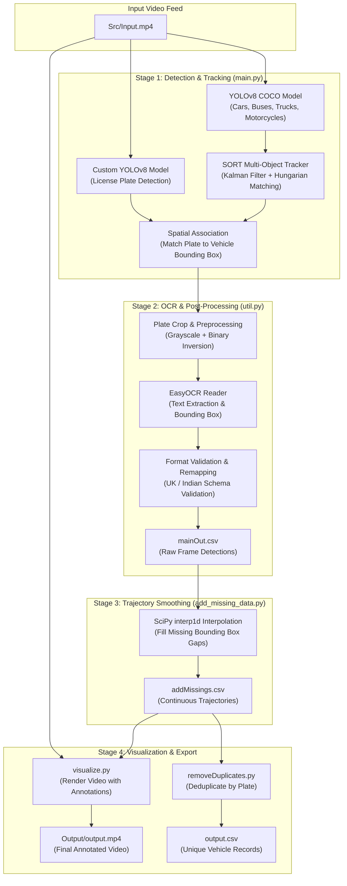

# Automatic Number Plate Recognition (ANPR) & Vehicle Tracking Pipeline

[](https://www.python.org/)
[](https://github.com/ultralytics/ultralytics)
[](https://github.com/abewley/sort)
[](https://github.com/JaidedAI/EasyOCR)
[](https://opencv.org/)

An end-to-end Computer Vision and Deep Learning pipeline for real-time vehicle tracking, license plate localization, optical character recognition (OCR), syntax-guided character disambiguation, and temporal trajectory interpolation.

---

## Table of Contents

- [Overview](#overview)
- [Key Features](#key-features)
- [System Architecture](#system-architecture)
- [Pipeline Workflow](#pipeline-workflow)
- [Project Structure](#project-structure)
- [Prerequisites & Installation](#prerequisites--installation)
- [Step-by-Step Usage Guide](#step-by-step-usage-guide)
- [CSV Output Schema](#csv-output-schema)
- [Technical Highlights & Algorithms](#technical-highlights--algorithms)
- [Troubleshooting & FAQs](#troubleshooting--faqs)
- [License & Acknowledgments](#license--acknowledgments)

---

## Overview

Automatic Number Plate Recognition (ANPR) in real-world video surveillance faces multiple operational challenges: fast vehicle motion, varying camera angles, glare, occlusion, and missing detections across consecutive frames.

This project delivers a multi-stage modular vision system:

1. **Vehicle Detection & Tracking:** Detects vehicles with a pre-trained **YOLOv8** model and tracks them across frames using **SORT** (Kalman Filter + Hungarian Algorithm) to assign persistent track IDs.
2. **License Plate Localization:** Pinpoints number plates using a custom fine-tuned **YOLOv8** model.
3. **Spatial Association:** Matches license plate bounding boxes to host vehicles via bounding-box containment checks.
4. **Adaptive Image Processing & OCR:** Preprocesses plate crops using grayscale inversion thresholding, followed by **EasyOCR** extraction.
5. **Syntax-Guided Validation:** Enforces standardized schemas (e.g., UK 7-character and Indian 10-character formats) and performs rule-based character disambiguation (e.g., `O` vs `0`, `I` vs `1`).
6. **Trajectory Interpolation:** Uses **SciPy 1D interpolation** to fill gaps caused by temporary occlusions or detector misses.
7. **Production Overlay Visualization:** Generates an annotated video with stylized vehicle corner brackets, cropped plate previews, and recognized text tags.

---

## Key Features

- **Dual YOLOv8 Detection Architecture:** Decouples full-frame vehicle localization (`yolov8n.pt`) from fine-grained license plate bounding box regression (`weights/best.pt`).
- **Real-Time Multi-Object Tracking (SORT):** Assigns persistent IDs across frames, eliminating identity swaps with Kalman Filter motion prediction and linear sum assignment.
- **Context-Aware Character Disambiguation:** Resolves common OCR ambiguities (`O` ↔ `0`, `I` ↔ `1`, `A` ↔ `4`, `S` ↔ `5`, `G` ↔ `6`, `J` ↔ `3`) by enforcing position-dependent schema syntax rules.
- **Missing Frame Data Interpolation:** Bridges dropped frames and momentary detection loss via linear spline interpolation (`scipy.interpolate.interp1d`).
- **Rich Video Annotations:** Produces polished video output featuring custom vehicle bracket borders, highlighted plate crops, and high-contrast text overlays.
- **Deduplicated Data Export:** Exports clean, unique vehicle-to-plate mapping tables for audit and database storage.

---

## System Architecture




---

## Pipeline Workflow

| Step  | Script / Module       | Input                              | Output              | Purpose                                                               |
| ----- | --------------------- | ---------------------------------- | ------------------- | --------------------------------------------------------------------- |
| **1** | `main.py`             | `Src/Input.mp4`, `weights/`        | `mainOut.csv`       | Vehicle detection, SORT tracking, plate detection, OCR extraction.    |
| **2** | `add_missing_data.py` | `mainOut.csv`                      | `addMissings.csv`   | Linear interpolation of missing frames for smoother tracking.         |
| **3** | `visualize.py`        | `addMissings.csv`, `Src/Input.mp4` | `Output/output.mp4` | Video rendering with bounding boxes, plate crops, and text overlays.  |
| **4** | `removeDuplicates.py` | `addMissings.csv`                  | `output.csv`        | Filter out duplicate frame entries to produce one record per vehicle. |

---

## Project Structure

```
Automatic-Number-Plate-Recognition-Using-Machine-Learning/
├── Src/                     # Input directory for raw video files (e.g. Input.mp4)
├── Output/                  # Output directory for rendered videos (e.g. output.mp4)
├── weights/                 # Model weight files
│   └── best.pt              # Fine-tuned YOLOv8 weights for license plate detection
├── sort/                    # SORT (Simple Online and Realtime Tracking) module
│   └── sort.py              # Kalman Filter & Hungarian algorithm implementation
├── model/                   # Model definition and checkpoint storage
├── Train&Test.ipynb         # Jupyter notebook for model training, validation & testing
├── main.py                  # Primary detection, tracking, and OCR extraction script
├── util.py                  # OCR helper, license plate schema validator, and CSV writer
├── add_missing_data.py      # Bounding box trajectory interpolation using SciPy
├── visualize.py             # Video rendering and overlay visualization pipeline
├── removeDuplicates.py      # CSV utility to deduplicate detections per unique license plate
├── yolov8n.pt               # Pretrained COCO YOLOv8 nano model
├── requirements.txt         # Project dependencies
└── README.md                # Project documentation
```

---

## Prerequisites & Installation

### 1. Prerequisites

- **Python**: Version 3.9 or higher
- **Hardware**: GPU with CUDA support recommended for faster inference, CPU is also fully supported.

### 2. Environment Setup

Clone the repository and set up a Python virtual environment:

```bash
# Clone repository
git clone https://github.com/Aries-Surya/Automatic-Number-Plate-Recognition-Using-Machine-Learning.git
cd Automatic-Number-Plate-Recognition-Using-Machine-Learning

# Create virtual environment
python -m venv venv

# Activate environment
# On Linux / macOS:
source venv/bin/activate

# On Windows (Command Prompt / PowerShell):
.\venv\Scripts\activate
```

### 3. Install Dependencies

```bash
pip install --upgrade pip
pip install -r requirements.txt
```

### 4. Prepare Folders and Model Weights

Ensure required folders and weight files are in place:

```bash
# Create input and output folders if they do not exist
mkdir -p Src Output

# Verify model weights:
# 1. weights/yolov8n.pt (COCO model for vehicles) or root yolov8n.pt
# 2. weights/best.pt (Fine-tuned model for license plates)
```

Place your input test video inside `Src/` (default filename: `Input.mp4`).

---

## Step-by-Step Usage Guide

### Step 1: Run Detection, Tracking, and OCR

Execute `main.py` to analyze the video feed:

```bash
python main.py
```

- Reads `Src/Input.mp4`.
- Detects vehicles (`car`, `motorcycle`, `bus`, `truck`) and tracks them using SORT.
- Detects license plates and assigns each plate to its parent vehicle.
- Preprocesses plate crops and runs EasyOCR with syntax validation.
- Writes raw detection records to `mainOut.csv`.

---

### Step 2: Interpolate Missing Data

When vehicles temporarily pass under shadows, experience motion blur, or are occluded, bounding boxes might drop for a few frames. Run `add_missing_data.py` to linearly interpolate missing coordinates:

```bash
python add_missing_data.py
```

- Reads `mainOut.csv`.
- Computes linear trajectory gaps using `scipy.interpolate.interp1d`.
- Generates `addMissings.csv` with smooth continuous tracking for every vehicle ID.

---

### Step 3: Render Annotated Video Output

Generate the final visual output video with bounding boxes, vehicle identifiers, and overlay panels:

```bash
python visualize.py
```

- Reads `addMissings.csv` and `Src/Input.mp4`.
- Selects the highest-confidence OCR reading for each unique vehicle track.
- Draws stylized corner-bordered bounding boxes around vehicles.
- Places the cropped plate image and recognized text in an overlay above the vehicle.
- Saves the final video to `Output/output.mp4`.

---

### Step 4: Export Deduplicated Plate Records

To extract a clean summary of every unique vehicle and its recognized license plate:

```bash
python removeDuplicates.py
```

- Reads `addMissings.csv`.
- Filters out duplicate frame detections and outputs `output.csv`.

---

## CSV Output Schema

Both `mainOut.csv` and `addMissings.csv` follow a standardized format:

| Column Name                | Type          | Description                                                    |
| -------------------------- | ------------- | -------------------------------------------------------------- |
| `frame_nmr`                | `int`         | Sequential video frame index (0-indexed).                      |
| `car_id`                   | `float / int` | Persistent tracking ID assigned to the vehicle by SORT.        |
| `car_bbox`                 | `string`      | Bounding box coordinates `[x1 y1 x2 y2]` of the vehicle.       |
| `license_plate_bbox`       | `string`      | Bounding box coordinates `[x1 y1 x2 y2]` of the license plate. |
| `license_plate_bbox_score` | `float`       | Detection confidence score from YOLOv8 license plate detector. |
| `license_number`           | `string`      | Extracted and formatted license plate alphanumeric string.     |
| `license_number_score`     | `float`       | OCR confidence score from EasyOCR.                             |

---

## Technical Highlights & Algorithms

### 1. Spatial Containment Association (`util.py`)

To prevent false-pairing when multiple cars are visible, the system checks whether the license plate coordinates are fully enveloped within the candidate vehicle's bounding box:

$$\text{Plate} \subseteq \text{Car} \iff (x_{1}^{p} > x_{1}^{c}) \land (y_{1}^{p} > y_{1}^{c}) \land (x_{2}^{p} < x_{2}^{c}) \land (y_{2}^{p} < y_{2}^{c})$$

### 2. Adaptive Binary Inversion

License plate crops are transformed to grayscale and thresholded using inverse binary thresholding:

```python
license_plate_crop_gray = cv2.cvtColor(license_plate_crop, cv2.COLOR_BGR2GRAY)
_, license_plate_crop_thresh = cv2.threshold(license_plate_crop_gray, 64, 255, cv2.THRESH_BINARY_INV)
```

This isolates characters as foreground elements against backgrounds of varying illumination and paint reflectance.

### 3. Syntax Rules & Character Disambiguation

Optical character recognition often misclassifies similar characters (e.g., numeral `0` as letter `O`, or letter `I` as numeral `1`). The pipeline applies deterministic remapping based on character position in the plate syntax:

- **UK Standard (7 Characters):** `[A-Z]{2}` + `[0-9]{2}` + `[A-Z]{3}`
- **Indian Standard (10 Characters):** `[State Code: 2 letters]` + `[District: 2 digits]` + `[Series: 2 letters]` + `[Number: 4 digits]`

```python
# Bidirectional character mapping tables
dict_char_to_int = {'O': '0', 'I': '1', 'J': '3', 'A': '4', 'G': '6', 'S': '5'}
dict_int_to_char = {'0': 'O', '1': 'I', '3': 'J', '4': 'A', '6': 'G', '5': 'S'}
```

If an alphabet appears where a digit is required by schema, it is mapped via `dict_char_to_int`, and vice versa.

### 4. Trajectory Interpolation (`scipy.interpolate.interp1d`)

When a vehicle's plate is temporarily occluded between frame $f_{\text{prev}}$ and frame $f_{\text{curr}}$, linear 1D interpolation calculates synthetic intermediate coordinates:

$$x(f) = x_0 + \frac{f - f_0}{f_1 - f_0}(x_1 - x_0)$$

This avoids flickering bounding boxes in the final rendered video.

---

## Troubleshooting & FAQs

<details>
<summary><b>1. "No module named 'sort'" or LAPJV build issues</b></summary>

Ensure the `sort` folder is in your project directory and included in your Python path. If `lap` fails to compile on Windows, `sort/sort.py` automatically falls back to `scipy.optimize.linear_sum_assignment`.

</details>

<details>
<summary><b>2. EasyOCR download on first run</b></summary>

During the first run of `util.py` / `main.py`, EasyOCR automatically downloads CRAFT and recognition model weights (`~/.EasyOCR/`). Ensure you have an active internet connection on the first execution.

</details>

<details>
<summary><b>3. Video path errors on Windows vs Linux</b></summary>

In `main.py` and `visualize.py`, file paths such as `'Src/Input.mp4'` are standardized. Ensure your input video is correctly placed inside the `Src/` folder.

</details>

<details>
<summary><b>4. GPU Acceleration</b></summary>

To enable GPU acceleration for EasyOCR, set `gpu=True` in `util.py`:

```python
reader = easyocr.Reader(['en'], gpu=True)
```

Ensure that PyTorch with CUDA support is installed in your virtual environment.

</details>

---

## License & Acknowledgments

- **YOLOv8** by [Ultralytics](https://github.com/ultralytics/ultralytics) (AGPL-3.0 License).
- **SORT Tracker** by [Alex Bewley](https://github.com/abewley/sort) (GPL-3.0 License).
- **EasyOCR** by [Jaided AI](https://github.com/JaidedAI/EasyOCR) (Apache-2.0 License).
- **OpenCV** Computer Vision library.
